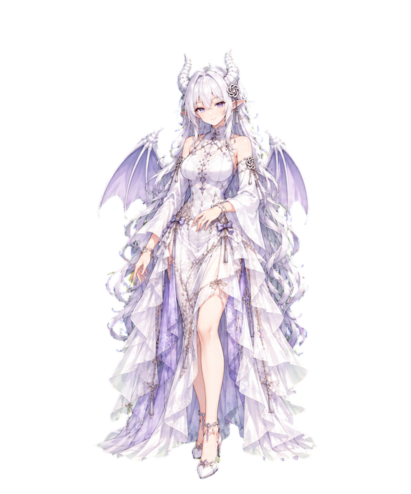
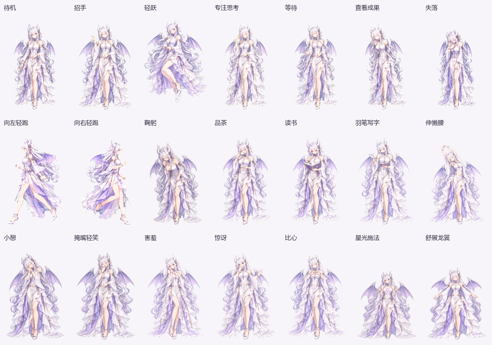
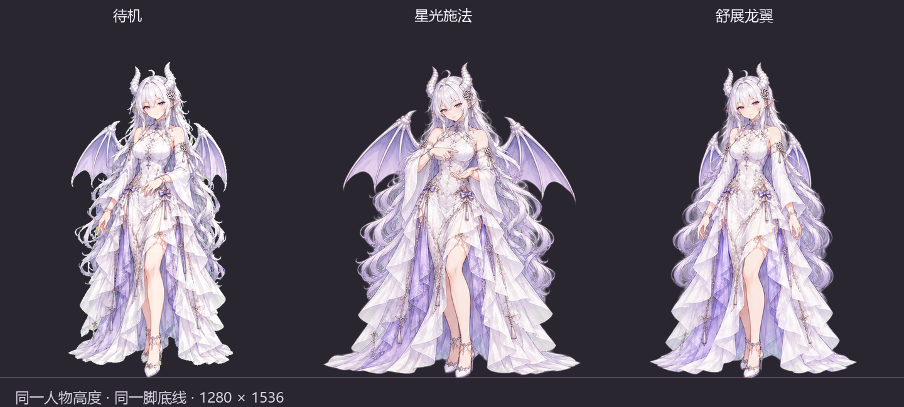

# Lumina Pet · 露米娜伴行

联动 Codex 工作状态的独立 Windows 银龙桌宠。银白长发、紫色眼睛与龙翼，支持 **21 种动作、1280 × 1536 透明动画、30 FPS 播放目标**，可以自由移动和放大。

## 下载与使用

支持 **Windows 10 / 11，64 位**，需要 .NET Framework 4.8。运行时无需安装 Python、Node.js 或额外编解码器。

1. 打开 [Releases 下载页面](https://github.com/williammhu/lumina-pet/releases/latest)。
2. 下载同一版本的 **两个 `Lumina-Windows-…-part1.zip` / `part2.zip` 文件**，并将它们解压到**同一个文件夹**。两个压缩包会合并成一个 `Lumina-Desktop` 目录。
3. 进入 `Lumina-Desktop`，双击 **`Lumina.exe`**。请保留旁边完整的 `assets` 文件夹。
4. 打开本机 Codex，桌宠会自动跟随最近活跃的主会话；也可在设置中指定会话。

两个 ZIP 是互补的程序资源包，**两份都需要下载**。完整高清动画体积较大，约 3 GB；仓库里的 **Code → Download ZIP** 仅包含源码与制作素材，不能直接运行。发布包同时提供 `SHA256SUMS.txt` 校验文件。

## 功能

- **Codex 状态联动**：思考、运行命令、编辑、搜索、生成图片、等待确认、完成和出错。
- **简洁脚边状态条**：只显示当前状态；设置中的“隐藏任务栏”可将其隐藏。
- **21 种动作**：右键点播、点击回应、空闲随机播放；Codex 工作状态会接管空闲动作。
- **自由缩放与移动**：支持置顶、鼠标穿透、静态立绘和视线跟随。
- **按需解码**：逐帧读取文件，复用像素和压缩缓冲，不把整套动画加载到内存。

| 操作 | 效果 |
| --- | --- |
| 拖动角色 | 移动位置 |
| 鼠标滚轮 | 放大 / 缩小 |
| 单击角色 | 随机动作回应 |
| 双击角色 | 回到 Codex |
| 右键角色或托盘图标 | 动作、设置、退出 |
| `Ctrl + Alt + P` | 显示 / 隐藏桌宠 |
| `Ctrl + Alt + L` | 开启 / 关闭鼠标穿透 |

角色大小受当前屏幕可用区域限制；开启鼠标穿透后可通过快捷键或托盘图标恢复操作。

## 动作一览

| 分组 | 动作 |
| --- | --- |
| 基础 | 待机、招手、轻跃、专注思考、等待、查看成果、失落、向左轻跑、向右轻跑 |
| 日常 | 鞠躬、品茶、读书、羽笔写字、伸懒腰、小憩 |
| 表情 | 掩嘴轻笑、害羞、惊讶、比心 |
| 银龙 | 星光施法、舒展龙翼 |

## 画质与性能

所有动画统一使用 **1280 × 1536** 透明画布，共 **1340 帧**。施法和展翼已固定人物高度与脚底线，展开翅膀时保持人物大小一致。

当前高清帧由已有素材高质量升采样生成，**并非重新绘制的原生 1K 细节**。动作采用关键帧与光流插值，局部仍可能出现轻微变形。

本机 v4.0.0 在大小设置 560、轮换全部动作并跟随真实 Codex 会话时，平均约 **29.2 FPS**，结束时内存工作集约 **125 MiB**，采样峰值约 **135 MiB**。这是一次本机测量，其他硬件、缩放比例和显示大小下的结果会不同。[查看验证记录](docs/validation-v4.json)。

## Codex 联动方式

这是独立程序，通过**只读本地 Codex 会话记录**判断工作状态，默认读取 `%USERPROFILE%\.codex`，支持 `CODEX_HOME` 和设置中的自定义路径。它不会读取登录凭据、调用模型 API、写入会话或自动确认操作，也不会启动网络服务。

状态更新受日志落盘速度影响，可能稍晚于内置桌宠。没有本机会话记录的云端任务无法跟随；Codex 日志格式变化也可能影响识别。设置与运行统计保存在 `%LOCALAPPDATA%\LuminaCompanion`。程序不会自动加入开机启动。

## 源码与构建

使用 **C# / .NET Framework 4.8 / WPF**，角色通过 Windows 原生透明窗口绘制，动画使用 Windows Compression API 的 XPRESS 格式。

- `lumina-desktop/src/`：桌宠程序和状态识别源码。
- `lumina-desktop/art/`：新增动作原始素材与生成提示词。
- `assets-src/`：基础动作关键帧、图标与静态立绘。
- `scripts/`：完整构建与发布打包工具。
- `docs/`：预览图、性能记录和构建说明。

只改程序代码时，先将发布包解压到 `outputs/`，再运行 `lumina-desktop/build.ps1`。从关键帧重建所有动画需要 Python、NumPy、Pillow 和 OpenCV，详见 [构建说明](docs/BUILDING.md)。

## 致谢与许可

动作分类和交互设计参考了 [dsh-pet](https://github.com/PC2005-cloud/dsh-pet)，未复制其代码或美术素材。图像素材使用 AI 生成，制作提示词随源码保留。

本项目采用 [MIT License](LICENSE)。这是独立的社区项目，与 OpenAI 无隶属关系。
